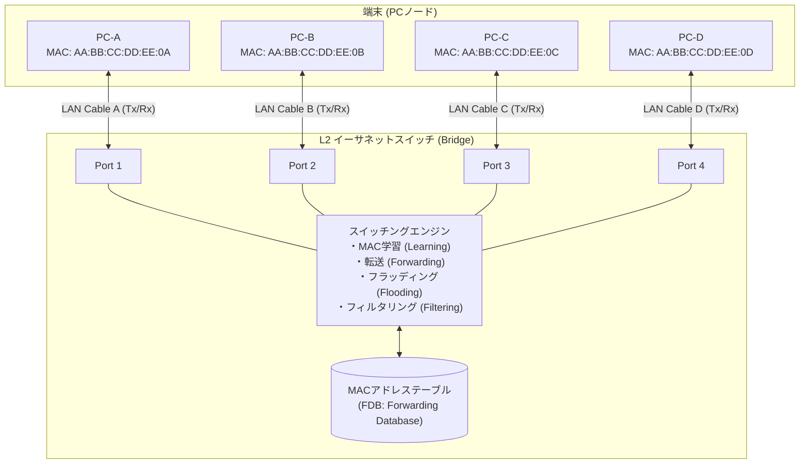

# 第2層（データリンク層）の拡張と限界：L2スイッチと4台のPCによる再発明記録

## 1. 今回実装した全体構成（スター型トポロジ）

1対1の直結ケーブル（Sender ↔ Receiver）から、中央に **L2スイッチ（学習型ブリッジ）** を配置し、4台のPC（A, B, C, D）が接続される「スター型トポロジ」へ進化させました。



---

## 2. 実装した主要コンポーネントの技術的解説

### ① 物理層の全二重化 (`src/Layers/DuplexPhysicalLayer.php`)
- **現実世界との対応**: 
  - 本物のイーサネットLANケーブル（UTPケーブル）の内部には、送信ペア線（Tx+ / Tx-）と受信ペア線（Rx+ / Rx-）が物理的に独立して入っており、**全二重通信（Full Duplex）** を行っています。
- **実装の仕組み**:
  - `port_{N}_to_switch`（PC送信 / スイッチ受信）と `switch_to_port_{N}`（スイッチ送信 / PC受信）の2本の名前付きパイプ（FIFO）を作成。
  - 相手プロセスの起動順序に関わらずブロックしないよう、ノンブロッキング I/O モードでオープン。

### ② L2スイッチ本体 (`src/Devices/L2Switch.php`)
L2スイッチは「データリンク層」で動作する機器であり、**フレームの中身（ペイロードやIPパケット）には一切手を加えず、MACヘッダだけを見て中継（ストア＆フォワード）** します。

```text
       受信フレーム (Preamble + SFD + DEST_MAC + SRC_MAC + LENGTH + PAYLOAD + FCS)
                                 │
           ┌─────────────────────┴─────────────────────┐
           ▼                                           ▼
【送信元MAC (SRC MAC) を参照】              【宛先MAC (DEST MAC) を参照】
  → 送信元ポート番号と紐付けて                → 転送先ポートを判定
    MACアドレステーブルに登録                   ├─ FF:FF:FF:FF:FF:FF ──→ 全ポートへ【フラッディング】
   (MAC学習 / Learning)                         ├─ テーブルに未登録 ────→ 全ポートへ【フラッディング】
                                               ├─ 受信元ポートと同じ ──→ 破棄 (フィルタリング)
                                               └─ テーブルに登録済み ──→ 該当ポートへ【ピンポイント転送】
```

### ③ PCノードの双方向化 (`src/node.php`)
- 各PCは **「常時受信待機しながら、いつでも送信できる端末」** として動作します。
- **NICのフィルタリング動作**:
  - フラッディングによって自分宛てではないフレームが届いた場合、NICのハードウェア処理に相当する部分で `DROP: dest is neither my MAC nor broadcast` として破棄し、上位層に無駄なデータを渡さない仕組みを実装しました。
- **起動方法**: 自分のMACアドレスと接続ポートは `config/nodes/*.json` に記述し、`php src/node.php --config=config/nodes/a.json` で起動します。引数（`--port`, `--mac`）や環境変数（`PORT`, `MACADDRESS`）を指定すると、設定ファイルより優先されます。
- **宛先の指定**: IPアドレスか `config/hosts` に登録した名前（`B` など）を指定すると、MACアドレスをARPで解決してIPv4パケットを送信します。12桁のMACアドレスや `ALL`、`--ethers` で読み込んだ名前を指定すると、IPを使わずに `0x88B5`（Local Experimental）のフレームとして直接送信します。
- **ARPキャッシュの確認**: 対話モードで `arp` と入力すると、そのノードのARPキャッシュを表示します。

### ④ パケットキャプチャ (`src/Devices/PcapWriter.php`)
- スイッチの起動時に環境変数 `CAPTURE_PATH` を指定すると、受信した正常なフレームを libpcap 形式で書き出します。実機のポートミラーリングに相当し、すべてのポートの通信を1つのファイルで確認できます。
- プリアンブル、SFD、FCS は通常のキャプチャと同様に含みません。FCS エラーなどで破棄したフレームも記録しません。
- Wireshark でライブ表示する場合は、スイッチを起動した後に次のコマンドを実行します。

```bash
CAPTURE_PATH=logs/capture.pcap php src/switch.php
```

```bash
tail -f -c +1 logs/capture.pcap | /Applications/Wireshark.app/Contents/MacOS/Wireshark -k -i -
```

### ⑤ ループ用のLANケーブル (`src/cable.php`)
- スイッチの2つのポートをつなぐケーブルです。片方のポートに届いた信号を、フレームとして解釈せずにそのままもう片方へ流します。
- 同じスイッチの2ポートをつなぐとループになり、ブロードキャストを1通送っただけでフレームが回り続けます（ブロードキャストストーム）。1秒ごとに、ケーブルを通過したフレームの数を表示します。
- `Ctrl+C` でプロセスを終了すると、ケーブルを抜いたときと同じくリンクダウンになり、ループが止まります。
- `--ports=5,6` で挿すポートを、`--delay-ms=500` で1フレームを通すごとに待つ時間を指定できます。待ち時間を入れると、ループの様子をゆっくり観察できます。

```bash
PORT_COUNT=6 php src/switch.php                # ケーブル用に Port 5, 6 を追加して起動
php src/node.php --config=config/nodes/a.json  # 別のターミナルで Port 1〜4 に PC をつなぐ
php src/cable.php --ports=5,6                  # 別のターミナルでケーブルを挿す
```

PC-A から `ALL hello` を送ると、スイッチのログと各PCの受信が止まらなくなります。PC-A の MAC アドレスも Port 1 / 5 / 6 の間を移動し続けます（MACフラッピング）。

#### 手動で試したときの観察結果

PC-A〜D を Port 1〜4 に、`cable.php` を Port 5, 6 につなぎ、PC-A から `ALL Hello` を1通だけ送りました。

**ループ中**
- **フレームが消えない**: ケーブルを Port 5 → 6、6 → 5 の両方向にそれぞれ毎秒約180フレームが流れ続け、約20秒で累計1万4千フレームを超えました。Ethernet ヘッダには TTL がないので、フレームが自然に消えることはありません。
- **MACフラッピング**: スイッチのログでは `AA:BB:CC:DD:EE:0A` が「Port 6 → Port 5」「Port 5 → Port 6」と数ミリ秒ごとに移動します。MACテーブル上の PC-A は、本当につながっている Port 1 ではなく Port 5 / 6 にいることになります。この状態で他のPCが PC-A 宛てにユニキャストを送ると、フレームはループの方へ転送され、PC-A には届きません。
- **全員に届き続ける**: 各PCに同じ "Hello" が毎秒何十回も届きます。送信した PC-A 自身にも、自分のブロードキャストが戻ってきます。
- **増え方**: 2ポートを1本のケーブルでつないだだけなので、回っているコピーは両方向に1本ずつです。フレームの数は倍々には増えず、一定の速さで回り続けます（速さはスイッチの処理速度で決まります）。スイッチ同士を三角形につなぐなど、フラッディングの分岐が増える構成では、コピーが増殖して回線が埋まる本当の「嵐」になります。

**ARP リクエストがループした場合** (PC-A から `192.168.1.4 hello`)

ARP リクエストもブロードキャストなので、同じようにループします。さらに、応答した側まで巻き込まれます。

1. PC-A の ARP リクエスト（192.168.1.4 は誰？）がループし、PC-D に何度も届きます。
2. PC-D は、届くたびに `192.168.1.4 is at AA:BB:CC:DD:EE:0D` とリプライを返します。
3. リプライは PC-A 宛てのユニキャストですが、スイッチは PC-A が Port 5 / 6 にいると思い込んでいるので、リプライをループの方へ転送します。PC-A にはリプライが届かず、ARP を解決できません。
4. ループを回ったリプライが Port 5 / 6 から戻ってくると、スイッチは送信元の PC-D まで Port 5 にいると学習し直します。

このときの MACテーブルは次のようになり、PC-A 宛てだけでなく PC-D 宛てのユニキャストまでループへ吸い込まれます。

```
Port 5 ↔ AA:BB:CC:DD:EE:0A  (hits: 9129)   ← PC-A (本当は Port 1)
Port 3 ↔ AA:BB:CC:DD:EE:0C  (hits: 1)
Port 5 ↔ AA:BB:CC:DD:EE:0D  (hits: 68)     ← PC-D (本当は Port 4)
```

実際のネットワークでは、PC の起動時やキャッシュ切れで自動的に送られる ARP や DHCP のブロードキャストがきっかけになるので、人が何も送らなくても、ケーブルを1本挿し間違えただけでネットワークが止まります。

**ケーブルを抜いた瞬間** (`cable.php` を `Ctrl+C`)
- Port 5, 6 がリンクダウンし、`[MAC削除] AA:BB:CC:DD:EE:0A (Port 6)` が出て MACテーブルが空になります。リンクダウンしたポートで学習したエントリは削除されるので、誤った位置情報は残りません。
- リンクダウンの後に、`[Port 5] フレーム受信` が1回だけ出ます。これは抜く前に伝送線（FIFO）へ書き込まれていた信号の残りです。リンクダウンしたポートなので送信元は学習せず、転送先も Port 1, 3, 4 だけになり、ループは止まります。実機でも、抜いた瞬間に伝送中だったフレームが届いたり途中で切れたりするのと同じです。

> 💡 この状態は電気的な「短絡（ショート）」ではなく、**L2ループ**と呼びます。信号は正常なまま回り続けるので、機器はどこも壊れていないのにネットワークだけが使えなくなります。実機のスイッチは、STP（スパニングツリー）で冗長なポートの片方を自動で遮断したり、ループを検知したポートを止めたりして防ぎます。

> 💡 同じ `FIFO_DIR` でスイッチが2台動いていると、1つのフレームの信号を2台で奪い合い、どちらも「フレームとして解釈できない信号」として破棄してしまいます。スイッチは `FIFO_DIR/switch.lock` をロックして、2台目の起動を拒否します。

---

## 3. 実験で観測された現象（動作検証）

`php src/experiment.php` で全実験をまとめて実行できます。観点ごとに `src/Experiments/` 以下のスクリプトを個別に実行することもできます。どの実験も、MACアドレステーブルが空のスイッチから始まります。

| 実験 | スクリプト | 通信内容 | スイッチの挙動 | PC側の挙動 |
| :--- | :--- | :--- | :--- | :--- |
| **未知ユニキャスト** | `unknown_unicast.php` | PC-A → PC-B<br/>(初回送信) | ・PC-A の MAC を Port 1 に**学習**<br/>・宛先 PC-B が未知のため、**Port 2, 3, 4 へフラッディング** | ・PC-B: ⭕ 受信成功<br/>・PC-C / D: ⚠️ フラッディングで届いたが NIC で **DROP (破棄)** |
| **学習済みユニキャスト** | `known_unicast.php` | PC-B → PC-A<br/>(準備として PC-A → PC-B を送信した後の返信) | ・PC-B の MAC を Port 2 に**学習**<br/>・宛先 PC-A は Port 1 と知っているため、**Port 1 にだけピンポイント転送** | ・PC-A: ⭕ 受信成功<br/>・PC-C / D: 🛡️ **フレーム非到達** (無駄なトラフィックなし / 盗聴防止) |
| **ブロードキャスト** | `broadcast.php` | PC-A → ALL<br/>(ブロードキャスト) | ・宛先が `FF:FF:FF:FF:FF:FF` のため、**全ポート (2, 3, 4) へフラッディング** | ・PC-B, C, D: 📢 **全員が受信** |
| **EtherType** | `ethertype.php` | PC-A → PC-B<br/>(IPv4, ARP, IPv6, 未対応の種別) | ・種別を問わず**すべて転送** | ・PC-B: ⭕ **EtherType から種別を識別** |
| **不正なフレーム** | `invalid_frames.php` | PC-A → PC-B<br/>(正常, FCSエラー, 短すぎるフレーム) | ・正常なフレームのみ転送し、**不正なものは破棄** | ・PC-B: ⭕ 正常なフレームのみ受信 |
| **自局宛て** | `self_delivery.php` | PC-A → PC-A | ・送信元と宛先が同じポートのため**破棄 (フィルタリング)** | ・PC-A: ⭕ **自分のMACで受信**<br/>・PC-B, C, D: 🛡️ フレーム非到達 |
| **PCの移動** | `station_move.php` | PC-A を Port 1 → 5 へ移動した後、PC-B → PC-A | ・PC-A が送信するまで**古い Port 1 へ転送**<br/>・PC-A の送信で**テーブルを更新** | ・PC-A: ❌ 移動直後は届かない → ⭕ PC-A の送信後は受信 |
| **ポートの入れ替え** | `port_swap.php` | PC-A と PC-C の接続先を入れ替えた後、PC-B → PC-A | ・入れ替えを知らず、**古い Port 1 (今は PC-C) へ転送** | ・PC-A: 🛡️ 届かない<br/>・PC-C: ⚠️ NIC で破棄。プロミスキャスなら 👀 内容を読める |
| **リンク状態** | `link_state.php` | PC-C と PC-A のケーブルを抜き差しして送信 | ・リンクダウンしたポートには**転送しない**<br/>・そのポートで学習した**エントリを削除** | ・抜いている間のフレームは受け取らない<br/>・挿し直して送信すると、再び学習される |
| **エージング** | `aging.php` | PC-A を移動した後、保持時間 (実験では2秒) の前後で PC-B → PC-A | ・保持時間切れで**エントリを削除**<br/>・宛先が未知に戻り**フラッディング** | ・PC-A: ❌ 保持時間内は届かない → ⭕ 切れた後は受信<br/>・PC-C / D: ⚠️ フレームが届く |
| **フラッディングの盗聴** | `flood_sniffing.php` | PC-A → PC-B、返信の後に再度 PC-A → PC-B<br/>(PC-D はプロミスキャス) | ・1通目はフラッディング<br/>・学習後の2通目はピンポイント転送 | ・PC-D: 👀 **1通目を読める** → 🛡️ 2通目は届かない |
| **MACアドレスの詐称** | `mac_spoofing.php` | PC-D が送信元を PC-A と偽って送信した後、PC-B → PC-A | ・送信元を検証せず**テーブルを書き換える** | ・PC-A: 🛡️ 届かない<br/>・PC-D: 👀 **PC-A 宛てを受信** |
| **MACテーブルの溢れ** | `table_overflow.php` | PC-D が偽の送信元でテーブルを埋めた後、PC-A ⇄ PC-B<br/>(実験では容量4) | ・新しいアドレスを**学習できず、フラッディングが続く** | ・PC-D: 👀 **すべての通信を読める** |
| **ループ** | `loop_storm.php` | Port 5 と Port 6 をケーブルでつないで、PC-A がブロードキャストを1通送信 | ・フレームが**回り続ける**<br/>・PC-A の MAC が**ポート間を移動し続ける** | ・各 PC に同じフレームのコピーが届き続ける |
| **ARP** | `arp.php` | PC-A → 192.168.1.2<br/>(MAC アドレスは未解決) | ・リクエストを**フラッディング**<br/>・リプライはユニキャスト転送 | ・PC-B: ⭕ 応答し、パケットを受信<br/>・PC-C: 🛡️ 応答も学習もしない |
| **IPv4** | `ipv4.php` | PC-A → PC-B<br/>(正常, チェックサム不一致, IP 宛先が別) | ・MAC アドレスだけを見て転送 | ・PC-B: ⭕ 正常なパケットのみ受信し、**全長の欄でパディングを除去** |

---

## 4. この実験から浮き彫りになった「L2レイヤーの限界」

なぜ世界中をL2スイッチだけで相互接続できないのか？ なぜL3（ネットワーク層・IP・ルーター）が必要なのか？

### 限界 1: フラッディングの嵐（ブロードキャストドメインの肥大化）
- **現象**: 
  - 未知の宛先への送信やブロードキャスト（ARP要求など）は、L2スイッチによって**同一ネットワーク内の全ポートに複製送出**されます。
- **限界**:
  - ノードが4台なら無視できますが、これが1,000台、10万台になったら？
  - 1台が通信を開始したりARPを打つたびに、10万台全員のNICがパケットを受け取り、CPUが割り込み処理で圧迫されます（**ブロードキャストストーム**）。
  - **L2スイッチはブロードキャストを遮断する境界を作ることができません**。
  - 👉 **L3ルーターが必要な理由**: ルーターはブロードキャストパケットを中継せずに破棄し、ネットワークを適切なサイズ（ブロードキャストドメイン）に「分割」する境界線になります。

### 限界 2: フラットなアドレッシングによる「テーブル爆発」
- **現象**:
  - MACアドレスは製造時にベンダーID＋シリアル番号で割り振られた「フラット（平坦）な識別子」です。
- **限界**:
  - 「192.168.1.0/24 はこちらのポート」というような**階層構造やグループ化（経路集約 / サマライゼーション）ができません**。
  - 世界中をL2スイッチで繋ごうとすると、世界中の数十億台すべてのMACアドレスを各スイッチのMACテーブルに1台ずつ登録しなければならず、メモリ容量が破綻します。
  - 👉 **L3 (IPアドレス) が必要な理由**: IPアドレスは「ネットワーク部（都道府県・プロバイダ相当）」と「ホスト部（番地相当）」に分かれており、ルーターは「このネットワーク宛て」とまとめてルーティングできます。

### 限界 3: ループ耐性の欠如（TTLが存在しない！）
- **現象**:
  - 障害耐性（冗長性）のためにL2スイッチ同士をループ状（網目状）に接続すると、フラッディングされたフレームがスイッチ間をぐるぐる回り続けます。
- **限界**:
  - イーサネットヘッダには **TTL (Time to Live / 生存可能ホップ数) フィールドが存在しません**。
  - 一度ループしたフレームは物理回線がパンクするか電源を切るまで永遠に消えません（※L2ではSTP: Spanning Tree Protocolで一部ポートを意図的に遮断して回避しますが、帯域の無駄や収束時間の問題があります）。
  - 👉 **L3 (IPパケット) が必要な理由**: IPヘッダには必ず `TTL` があり、ルーターを経由するたびに 1 減算され、0 になったら破棄（ICMP Time Exceeded）されるため、絶対に永久ループしません。

### 限界 4: 異機種ネットワークの統合不可
- イーサネット以外の通信方式（Wi-Fi、光回線のPPP、LTE/5Gのパケット通信など）はそれぞれフレーム構造が異なります。L2だけでは、異なる規格の物理メディア同士をシームレスにつなぐことができません。
- 👉 共通のヘッダフォーマットとして **IP（Internet Protocol）** が上位に乗ることで、異種メディア間の中継が可能になります。

---

## 5. 推薦資料・文献

技術理解を深めるための代表的な文献・RFCです：

1. **IEEE 802.1D (MAC Bridges)**:
   - スイッチ（透過型ブリッジ）の標準規格。MACアドレス学習（Learning）、フォワーディング（Forwarding）、フラッディング（Flooding）、エージング（Aging）、およびスパニングツリープロトコル（STP）の仕様が定義されています。
2. **IEEE 802.3 (Ethernet)**:
   - イーサネットフレームフォーマット、プリアンブル、SFD、MACアドレス、FCS（CRC-32）の公式規格。
3. **書籍『マスタリングTCP/IP 入門編』（オーム社）**:
   - 第3章「データリンク」および第4章「IPプロトコル」。ハブとスイッチの違い、ブロードキャストドメイン、なぜIPが必要なのかが図解で最もわかりやすくまとまっています。
4. **書籍『ネットワークはなぜつながるのか』（日経BP / 戸根勤 著）**:
   - 第2章「LANのパケットを運ぶ機器：スイッチング・ハブとルーターの探検」。スイッチがパケットを受信してから宛先ポートに送出するまでのハードウェア・バッファ・テーブルの物理的な挙動が詳細に解説されています。
5. **RFC 826 (An Ethernet Address Resolution Protocol - ARP)**:
   - L3のIPアドレスからL2のMACアドレスを解決する仕組み。未知の相手に対して「ブロードキャスト」を使ってMACアドレスを問い合わせる、L2とL3の架け橋となるプロトコルです。

