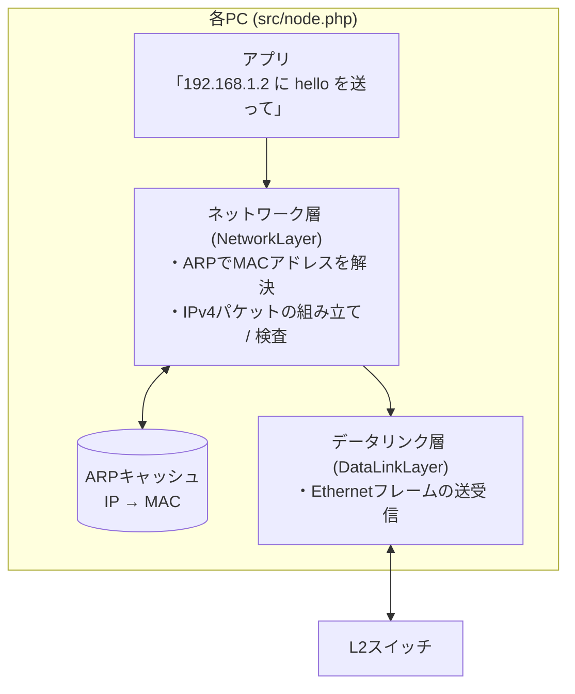

# 第3層（ネットワーク層）の入口：ARPとIPv4による再発明記録

[L2スイッチと4台のPC実験](L2SwitchAndLimits.md) では、PCはMACアドレスを指定してフレームを送っていました。ここでは、その上に **ARP** と **IPv4** を実装し、PCがIPアドレスだけで相手に送れるようにします。

ルーターはまだ実装していないので、すべてのPCが同じネットワーク（`192.168.1.0/24`）にいる前提です。ネットワークをまたぐ通信は扱いません。

---

## 1. 今回実装した全体構成



アプリ（`node.php`）はIPアドレスを渡すだけで、ARPを意識しません。ARPは `NetworkLayer` の中に隠れています。普段使っているPCで、アプリがARPを意識しなくてよく、OSが代わりに処理しているのと同じ構造です。

---

## 2. 実装した主要コンポーネントの技術的解説

### ① ARP (`src/Layers/NetworkLayer/ArpPacket.php`, `ArpTable.php`)

ARP（Address Resolution Protocol, RFC 826）は、**IPアドレスからMACアドレスを調べる仕組み**です。

```text
PC-A → 全員   「192.168.1.2 は誰？ 192.168.1.1 に教えて」   (ARPリクエスト: ブロードキャスト)
PC-B → PC-A   「192.168.1.2 は aa:bb:cc:dd:ee:0b です」     (ARPリプライ: ユニキャスト)
PC-A → PC-B   IPv4 パケット本体を送信
```

- **パケットの形式**: Ethernet のEtherType `0x0806` で運ばれる28バイトのパケットです。ハードウェア種別（Ethernet）、プロトコル種別（IPv4）、アドレスの長さ、操作（リクエスト / リプライ）、送信元と宛先のMACアドレスとIPアドレスを持ちます。
- **受信時の処理**: RFC 826 の手順に沿っています。すでに知っている相手なら、宛先に関係なく情報を更新します。知らない相手を新しく覚えるのは、自分が尋ねられたときだけです。そのため、無関係なPCは他人のARPリクエストを受信しても何も覚えません。
- **ARPキャッシュ**: 調べた結果を60秒保持します。古い情報を消す仕組みは RFC 1122 で求められています。自分のIPアドレスとMACアドレスは、最初から静的に登録しています。
- **リクエストの間隔**: 同じ宛先へのリクエストは1秒に1回までにしています（RFC 1122 の推奨値）。
- **解決待ちのパケット**: MACアドレスが分かるまで、宛先ごとに最新の1つのパケットを保持し、リプライを受け取ったら送信します（RFC 1122）。
- **静的ARPエントリ**: 単方向の伝送線しかない `sender.php` はARPのリプライを受け取れないので、宛先のMACアドレスを静的に登録しています。

### ② IPv4 (`src/Layers/NetworkLayer/Ipv4Packet.php`, `IpAddress.php`)

IPv4パケットの形式は RFC 791 に沿っています。

| 項目 | 実装 |
| :--- | :--- |
| ヘッダ | 20バイト（オプションなし）。受信時はオプション付きも読み飛ばす |
| ヘッダチェックサム | 16ビットごとの1の補数和の、1の補数。合わないパケットは破棄する |
| TTL | 64 |
| フラグ | DF（分割禁止）を立てる。断片化は実装していないので、断片は受け取らない |
| プロトコル番号 | 253（RFC 3692 の実験用）。TCP や UDP はまだないので、実験用の番号を使う |
| 全長 | Ethernet のパディングを除くために使う（RFC 894） |

**パディングの扱い**: Ethernet のデータ部分は最小46バイトなので、短いデータの後ろにはゼロが詰められます。Ethernet II のフレームには長さの欄がないので、データリンク層では本来のデータの長さが分かりません。IPv4 ヘッダの全長を見て、初めてパディングを除けます。

### ③ ネットワーク層 (`src/Layers/NetworkLayer.php`)

| 宛先 | 動作 |
| :--- | :--- |
| 自分のIPアドレス | Ethernet には流さず、ネットワーク層で折り返して受信する |
| `255.255.255.255` | MACアドレスもブロードキャストにして送る（ARP不要） |
| ARPキャッシュにあるIPアドレス | そのMACアドレス宛てに、すぐ送る |
| ARPキャッシュにないIPアドレス | パケットを保持してARPリクエストを送り、リプライを受け取ったら送る |

受信したフレームは、EtherType で振り分けます。ARP なら ARP の処理に、IPv4 なら検査（バージョン、ヘッダ長、全長、チェックサム、宛先IPアドレス）をしてから上位に渡します。

### ④ メッセージの種別を正直にする（EtherType `0x88B5`）

最初は、MACアドレスを指定して送る文字列のメッセージも、EtherType を IPv4（`0x0800`）にしていました。Wireshark で見ると、中身が IPv4 パケットではないので `Malformed Packet` と表示されました。先頭の `h`（`0x68`）を、バージョン6として読もうとしていたためです。

そこで、IPを使わないメッセージは IEEE の **Local Experimental Ethertype**（`0x88B5`）で送るようにしました。Wireshark でも `Local Experimental Ethertype 1` と正しく表示されます。

### ⑤ PCノードでの使い方 (`src/node.php`)

- **IPアドレスで送る**: 対話モードで `192.168.1.2 こんにちは` と入力します。`config/hosts` に登録した名前（`B` など）も使えます。
- **ARPキャッシュを見る**: 対話モードで `arp` と入力すると、IPアドレス、MACアドレス、残りの保持時間を表示します。
- **ワンショット送信**: `--to` と `--message` で送ると、ARPのリプライを最大2秒待ちます。応答がなければ、エラーを表示して終了します。

> 💡 `config/hosts` は、`node.php` の起動時に1回だけ読み込みます。名前を追加した後は、PCを起動し直してください。

---

## 3. 手動で試したときの観察結果

### PC-A から `192.168.1.2 hello`（Wireshark の表示）

| No. | Time | Source | Destination | Protocol | Info |
| :--- | :--- | :--- | :--- | :--- | :--- |
| 1 | 0.000 | aa:bb:cc:dd:ee:0a | Broadcast | ARP | Who has 192.168.1.2? Tell 192.168.1.1 |
| 2 | 0.740 | aa:bb:cc:dd:ee:0b | aa:bb:cc:dd:ee:0a | ARP | 192.168.1.2 is at aa:bb:cc:dd:ee:0b |
| 3 | 1.493 | 192.168.1.1 | 192.168.1.2 | IPv4 | Unknown (253) |

- **Wireshark が自作のARPとIPv4を解釈した**: `Malformed` は出ず、プロトコルの中身まで読めています。
- **約0.75秒の間隔**: 物理層が1ビットずつ約1ミリ秒の間隔で信号を流しているためです。プリアンブルなども含めて1フレームが約580文字なので、計算が合います。`BIT_INTERVAL_US=0` にすると短くなります。
- **`Unknown (253)`**: 実験用のプロトコル番号なので、Wireshark はその先を解釈しません。エラーではありません。

### 同じARPリクエストを受け取ったPCの違い

PC-A から PC-C（`192.168.1.3`）宛てに送ったとき、3台のPCの画面は次のようになりました。

| PC | 画面 | 動作 |
| :--- | :--- | :--- |
| PC-C（尋ねられた） | `[NIC ACCEPT] {dest: BROADCAST, ... type: ARP}`<br/>`[ARP] 192.168.1.3 is at AA:BB:CC:DD:EE:0C` | 受信して応答する |
| PC-B（無関係） | `[NIC ACCEPT] {dest: BROADCAST, ... type: ARP}` | 受信するが、何もしない |

ブロードキャストなので、無関係な PC-B も受信して処理しています。ノードが増えるほど、この負担が全員に広がります。

### ARPキャッシュ（`arp` コマンド）

送信の後、各PCで `arp` を実行した結果です。

| PC | ARPキャッシュ | 理由 |
| :--- | :--- | :--- |
| PC-A（尋ねた） | 自分、PC-C（残り53秒） | 尋ねて、PC-C が答えたから |
| PC-C（尋ねられた） | 自分、PC-A（残り47秒） | リクエストに PC-A の情報があったから |
| PC-B（無関係） | 自分のみ | 自分宛ての質問ではないから |

PC-B は ARP リクエストを受信したのに、何も覚えていません。**受信することと、覚えることは別**です。残り秒数の違いは、`arp` を入力したタイミングの違いです。

### 長時間のキャプチャ（12フレーム）

| No. | 内容 | 分かること |
| :--- | :--- | :--- |
| 1〜3 | A → B の ARP と IPv4 | 基本の流れ |
| 4〜6 | A → C の ARP と IPv4 | 別の宛先には改めて尋ねる |
| 7 | `192.168.1.1 → 192.168.1.1` | 修正前の、自分宛てのパケット（下記） |
| 8 | `Who has 192.168.1.5?` | 誰も答えず、IPv4 も続かない |
| 9〜10 | A が B を再び尋ねる | ARPキャッシュの期限切れ（No. 1 から約20分後） |
| 11〜12 | B → A と A → B の IPv4 | B は ARP を送らずに A へ送れた（No. 9 のリクエストから A を覚えていた） |

- **自分宛てのパケット（No. 7）**: 最初の実装では、自分のIPアドレス宛てのパケットも Ethernet に流していました。実際のOSは、自分宛ての IP パケットをネットワークに流さず内部で折り返すのが普通なので、ネットワーク層で折り返すように直しました。
- **応答のない ARP（No. 8）**: 存在しない `192.168.1.5` を尋ねると、応答がないまま IPv4 は送られません。PC には `送信完了！` と表示されますが、これはARPリクエストを送ったという意味で、メッセージが届いたわけではありません。
- **IG ビットと LG ビット**: Wireshark の詳細で、宛先のブロードキャストアドレスの `IG bit: Group address` を確認できます。また、実験で使っている `aa:bb:...` の先頭バイト `0xAA`（`10101010`）は、IG ビットが0（個別アドレス）、LG ビットが1（ローカル管理アドレス）です。メーカーが割り当てたアドレスではないことを示すので、実験用のアドレスとして適切な値です。

---

## 4. 実験スクリプトで確認した結果

| 実験 | スクリプト | 通信内容 | スイッチの挙動 | PC側の挙動 |
| :--- | :--- | :--- | :--- | :--- |
| **ARP** | `arp.php` | PC-A → 192.168.1.2<br/>(MAC アドレスは未解決) | ・リクエストを**フラッディング**<br/>・リプライはユニキャスト転送 | ・PC-B: ⭕ 応答し、パケットを受信<br/>・PC-C: 🛡️ 応答も学習もしない |
| **IPv4** | `ipv4.php` | PC-A → PC-B<br/>(正常, チェックサム不一致, IP 宛先が別) | ・MAC アドレスだけを見て転送 | ・PC-B: ⭕ 正常なパケットのみ受信し、**全長の欄でパディングを除去** |

`arp.php` では、誰も使っていない `192.168.1.200` 宛てに送ると、応答がないままパケットが送られずに待ち続けることも確認しています。`ipv4.php` では、自分のIPアドレス宛てのパケットが Ethernet に流れずに受信できることも確認しています。

---

## 5. 未実装のこと

- **ルーティング**: 宛先が別のネットワークにある場合の処理（デフォルトゲートウェイ）がありません。すべての宛先を同じネットワークとして扱います。
- **ICMP**: エラーの通知（宛先に届かない、TTL切れなど）や `ping` がありません。
- **断片化**: 1480バイトを超えるデータは送れず、断片は受け取りません。
- **TCP、UDP**: プロトコル番号 253 の実験用パケットだけを使っています。
- **ARPの再送と失敗の通知**: 対話モードでは、応答がなくても再送せず、失敗も通知しません。
- **ARPの検証**: 応答が本物かどうかを確かめないので、偽の応答で通信を横取りする攻撃（ARPスプーフィング）が考えられます。
- **IPv6**: EtherType で識別するだけで、中身は扱いません。

---

## 6. 参考資料

1. **RFC 826 (An Ethernet Address Resolution Protocol)**: ARP のパケット形式と、受信時の処理手順。
2. **RFC 791 (Internet Protocol)**: IPv4 のヘッダ形式とチェックサム。
3. **RFC 894 (A Standard for the Transmission of IP Datagrams over Ethernet Networks)**: Ethernet で IP を運ぶときの EtherType とパディング。
4. **RFC 1122 (Requirements for Internet Hosts)**: ARPキャッシュの期限切れ、リクエストの間隔、解決待ちのパケットの扱い。
5. **RFC 3692**: 実験用のプロトコル番号（253、254）。
6. **IANA のプロトコル番号、EtherType の一覧**: `0x0800`（IPv4）、`0x0806`（ARP）、`0x88B5`（Local Experimental）など。
