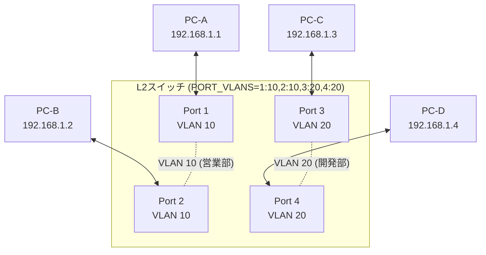
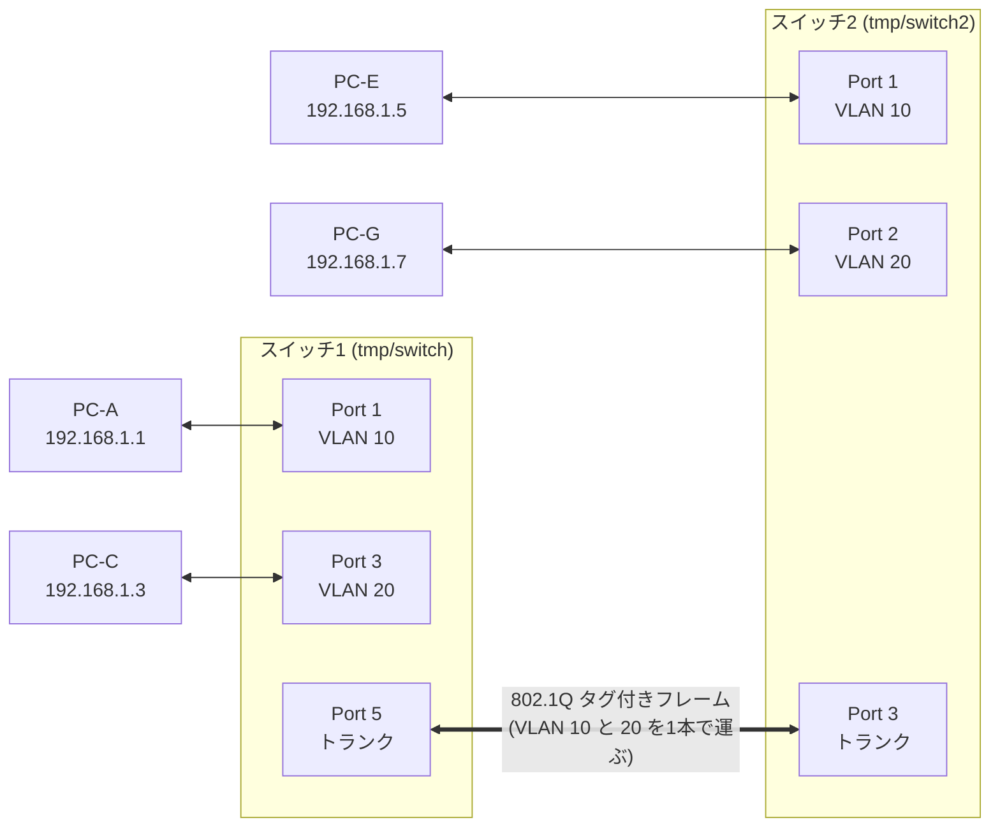

# 第2層の論理分割：VLANとトランク（IEEE 802.1Q）による再発明記録

[L2スイッチと4台のPC実験](L2SwitchAndLimits.md) では、1台のスイッチにつながったPCが全員同じネットワークにいました。そのため、ブロードキャストや未知の宛先へのフラッディングが全員に届き、盗聴もできてしまいました。

ここでは、スイッチに **VLAN（Virtual LAN）** を実装して、配線を変えずにネットワークを論理的に分けます。さらに **トランクポート** と **IEEE 802.1Q のタグ** を実装して、分けたネットワークを2台のスイッチにまたがって延ばします。

---

## 1. 今回実装した全体構成

### 構成1: 1台のスイッチを2つのVLANに分ける



物理的には同じスイッチにつながっていますが、VLAN 10 と VLAN 20 は別々のネットワークとして動きます。1台のスイッチが、2台のスイッチのように振る舞います。

### 構成2: 2台のスイッチをトランクでつなぎ、VLANを延ばす



PC-A と PC-E は別々のスイッチにつながっていますが、同じ VLAN 10 のネットワークにいます。PC-C と PC-G も同様に VLAN 20 です。

---

## 2. 実装した主要コンポーネントの技術的解説

### ① ポートVLAN (`src/Devices/L2Switch.php`)

スイッチは、フレームごとに「どのVLANに属するか」を決め、同じVLANの中だけで学習と転送を行います。

```text
       受信フレーム
            │
            ▼
【所属するVLANを決める】
  ・アクセスポート: 受信したポートのVLAN
  ・トランクポート: タグのVLAN ID (タグなしならネイティブVLAN)
            │
            ├──→ 送信元MACを「VLAN + MAC」の組で学習
            │
            ▼
【転送先を決める (同じVLANのポートだけが候補)】
  ├─ ブロードキャスト / マルチキャスト ─→ 同じVLANのポートへフラッディング
  ├─ そのVLANでは未知の宛先 ───────→ 同じVLANのポートへフラッディング
  └─ そのVLANで学習済みの宛先 ─────→ 該当ポートへピンポイント転送
```

- **ポートへの割り当て**: スイッチの起動時に `PORT_VLANS=1:10,2:10,3:20,4:20` のように指定します。指定しなかったポートは VLAN 1 に属するので、`PORT_VLANS` を付けなければ今までのスイッチと同じ動きです。
- **MACアドレステーブル**: キーを「VLAN ID と MACアドレスの組」にしているので、VLANごとに別々に学習します。同じMACアドレスでも、VLANが違えば別のエントリです。
- **VLAN ID の範囲**: 1〜4094 です。0 と 4095 は予約されています。範囲外の値や存在しないポートを指定すると、スイッチは起動しません。
- **PC側の変更は不要**: PCは自分がどのVLANにいるかを知りません。VLANはスイッチの中だけの区別です。

### ② IEEE 802.1Q タグ (`src/Layers/DataLinkLayer/EthernetFrame.php`)

1台のスイッチの中ならポートの設定だけでVLANを区別できますが、スイッチ同士をつなぐ線では、フレームがどのVLANのものかを書き込む必要があります。そこで、送信元MACアドレスとEtherTypeの間に4バイトのタグを差し込みます。

```text
タグなし: │ 宛先MAC (6) │ 送信元MAC (6) │                    │ EtherType (2) │ データ │ FCS (4) │
タグ付き: │ 宛先MAC (6) │ 送信元MAC (6) │ TPID (2) │ TCI (2) │ EtherType (2) │ データ │ FCS (4) │
                                         0x8100     ↓
                                    ┌─────────┬─────────┬──────────────────┐
                                    │ PCP (3) │ DEI (1) │   VLAN ID (12)   │
                                    └─────────┴─────────┴──────────────────┘
```

| 部分 | 大きさ | 内容 |
| :--- | :--- | :--- |
| TPID | 16ビット | `0x8100`。タグなしフレームのEtherTypeと同じ位置にあり、「この後ろにタグがある」ことを示す |
| PCP | 3ビット | 優先度（音声などを優先して扱うために使う） |
| DEI | 1ビット | 混雑時に破棄してよいかどうかの印 |
| VLAN ID | 12ビット | VLANの番号。0〜4095 のうち 0 と 4095 は予約 |

- **FCSの計算し直し**: タグを付けたり外したりするとフレームの中身が変わるので、FCSを計算し直します。
- **フレームの長さ**: 最大長はタグの分だけ伸びて 1522バイト（タグなしは1518バイト）、最小長は64バイトのままです。
- **パーサ** (`EthernetFrameParser.php`): EtherTypeの位置に `0x8100` があればタグ付きとして解釈し、その後ろの2バイトをTCI、さらに後ろを本来のEtherTypeとして読みます。

### ③ アクセスポートとトランクポート (`src/Devices/L2Switch.php`)

| ポート | つなぐ相手 | 受信したフレーム | 送信するフレーム |
| :--- | :--- | :--- | :--- |
| **アクセスポート** | PC | タグなしなら、ポートのVLANとして扱う。タグ付きは破棄する | タグを外して送る |
| **トランクポート** | 別のスイッチ | タグのVLAN IDで判断する。タグなしならネイティブVLAN | タグを付けて送る（ネイティブVLANはタグなし） |

- **トランクの指定**: `TRUNK_PORTS=5` のように指定します。トランクポートは、すべてのVLANのフレームを通します。
- **ネイティブVLAN**: `PORT_VLANS` でトランクポートに指定したVLANです（未指定なら VLAN 1）。このVLANのフレームは、トランクでもタグなしで送受信します。
- **タグの付け外しは最小限**: 送信先に合わせてタグを変える必要がなければ、受信した信号をそのまま転送します。
- **アクセスポートのタグ付きフレームを破棄する理由**: PCがタグを偽装して別のVLANに入り込むこと（VLANホッピング）を防ぐためです。

### ④ 2台のスイッチをつなぐケーブル (`src/cable.php`)

ループの実験で使ったケーブルに `--fifo-dirs` を追加し、別々のスイッチのポートをつなげるようにしました。

```bash
php src/cable.php --ports=5,3 --fifo-dirs=tmp/switch,tmp/switch2   # スイッチ1の Port 5 と スイッチ2の Port 3 をつなぐ
```

2台目のスイッチにつなぐPC（`config/nodes/e.json`、`g.json`）は、設定ファイルの `fifoDir` で2台目のスイッチの伝送線を使います。環境変数 `FIFO_DIR` を指定すると、設定ファイルより優先されます。

---

## 3. 手動で試す手順

スイッチ、PC、ケーブルのオプションの一覧は [実験環境の使い方](Tools.md) にまとめています。

### 構成1: 1台のスイッチ

```bash
PORT_VLANS=1:10,2:10,3:20,4:20 CAPTURE_PATH=logs/capture.pcap php src/switch.php
```

```bash
tail -f -c +1 logs/capture.pcap | /Applications/Wireshark.app/Contents/MacOS/Wireshark -k -i -
```

```bash
php src/node.php --config=config/nodes/a.json   # B, C, D も同様に別のターミナルで起動
```

### 構成2: 2台のスイッチとトランク

```bash
PORT_COUNT=5 PORT_VLANS=1:10,2:10,3:20,4:20 TRUNK_PORTS=5 php src/switch.php
```

```bash
FIFO_DIR=tmp/switch2 PORT_COUNT=3 PORT_VLANS=1:10,2:20 TRUNK_PORTS=3 CAPTURE_PATH=logs/capture2.pcap php src/switch.php
```

```bash
php src/cable.php --ports=5,3 --fifo-dirs=tmp/switch,tmp/switch2
```

```bash
tail -f -c +1 logs/capture2.pcap | /Applications/Wireshark.app/Contents/MacOS/Wireshark -k -i -
```

```bash
php src/node.php --config=config/nodes/a.json   # PC-E (e.json)、PC-G (g.json) も同様に起動
```

> 💡 スイッチを起動し直すとキャプチャファイルが作り直されるので、Wireshark も起動し直してください。古いまま動いていると、Wireshark は `Unknown error: -14` で止まります。

> 💡 `node.php` は、`config/hosts` を起動時に1回だけ読み込みます。`hosts` に名前を追加した後は、PCを起動し直すか、IPアドレスで直接送ってください。

---

## 4. 手動で試したときの観察結果

### 構成1: 1台のスイッチを VLAN 10 と VLAN 20 に分けた場合

**PC-A から `ALL 営業部のみなさんへ`**

スイッチのログでは、転送先が同じ VLAN 10 の Port 2 だけになりました。VLANがなければ Port 2, 3, 4 の全部に送るところです。

```text
[Port 1 / VLAN 10] フレーム受信
✨ [MAC学習] 新規登録: VLAN 10 の Port 1 に AA:BB:CC:DD:EE:0A を学習しました
👉 アクション: 📢 [FLOODING] ブロードキャストのため、VLAN 10 の Port 1 以外のポートへフラッディング！
   └─ 転送先: Port 2
```

PC-B だけが受信し、PC-C と PC-D には `[NIC ACCEPT]` も `DROP` も出ませんでした。NICが捨てたのではなく、フレームがそもそも届いていません。

**PC-C から `ALL 開発部のみなさんへ`**

今度は転送先が VLAN 20 の Port 4 だけになり、PC-D だけが受信しました。MACアドレステーブルには、VLANごとの行が並びます。

```text
VLAN 10   Port 1  ↔  AA:BB:CC:DD:EE:0A  (hits:  1)
VLAN 20   Port 3  ↔  AA:BB:CC:DD:EE:0C  (hits:  1)
```

同じスイッチにつながり、同じブロードキャストアドレス宛てなのに、届く範囲が VLAN で分かれています。

**PC-A から `C こんにちは`（別のVLANのPCへIPアドレスで送信）**

1. PC-A が `[ARP] Who has 192.168.1.3? Tell 192.168.1.1` を送信しました。
2. スイッチは ARP リクエストを VLAN 10 の Port 2 にだけフラッディングしました。
3. PC-B はリクエストを受信しましたが、自分のIPアドレスではないので応答しませんでした。
4. PC-C には届かず、誰も応答しないので、`こんにちは` の IPv4 パケットは送られませんでした。

PC-A には `送信完了！` と表示されますが、これはARPリクエストを送ったという意味で、メッセージが届いたわけではありません。**同じスイッチにつながっているのに、VLANが違うと話せない**状態です。ARPはブロードキャストで相手を探すので、ブロードキャストが届く範囲（ブロードキャストドメイン）の外にいる相手は見つけられません。

### 構成2: 2台のスイッチをトランクでつないだ場合

**PC-A から `ALL hello`**

フレームは次の順に運ばれ、別のスイッチにいる PC-E に届きました。VLAN 20 の PC-G には届いていません。

```text
スイッチ1  [Port 1 / VLAN 10] フレーム受信
           └─ 転送先: Port 5 (タグ VLAN 10)          ← トランクへ送るときにタグを付ける
ケーブル   Port 5 → Port 3: 1 フレーム/秒
スイッチ2  [Port 3 / VLAN 10] フレーム受信 (802.1Qタグ付き)   ← タグを見て VLAN 10 と判断
           ✨ [MAC学習] 新規登録: VLAN 10 の Port 3 に AA:BB:CC:DD:EE:0A を学習しました
           └─ 転送先: Port 1                          ← PC-E へはタグを外して送る
```

スイッチ2は、ポートの設定ではなく**タグを見て** VLAN 10 と判断しています。また、PC-A の本当の場所は知らず、「トランクの先（Port 3）にいる」とだけ学習しています。PC-E の `[NIC ACCEPT]` にもタグは出てきません。

**PC-A から `192.168.1.5 こんにちは`（別のスイッチにいる PC-E へIPアドレスで送信）**

ARP のやり取りも含めて、トランクを往復しました。

1. PC-A の ARP リクエストが、タグ VLAN 10 付きでトランクを越え、PC-E に届きました。
2. PC-E の ARP リプライが、トランクを逆向きに通って PC-A に届きました。
3. PC-A の IPv4 パケットが、トランクを越えて PC-E に届きました（`from 192.168.1.1: "こんにちは"`）。

ケーブルには、初めて両方向にフレームが流れました。

```text
[13:35:29] Port 5 → Port 3: 1 フレーム/秒, Port 3 → Port 5: 0 フレーム/秒   ← ARP リクエスト
[13:35:30] Port 5 → Port 3: 1 フレーム/秒, Port 3 → Port 5: 1 フレーム/秒   ← IPv4 と ARP リプライ
```

ARP のやり取りで両方の場所を学習したので、IPv4 はピンポイント転送になりました。スイッチ2の MACアドレステーブルは次のとおりです。

```text
VLAN 10   Port 3  ↔  AA:BB:CC:DD:EE:0A   ← PC-A はトランクの先
VLAN 10   Port 1  ↔  AA:BB:CC:DD:EE:0E   ← PC-E は直接つながっている
```

PC-A と PC-E は、別々のスイッチにつながっていることを知らず、同じスイッチの隣にいるのと同じように通信しています。

### Wireshark で見たスイッチ2のキャプチャ

| No. | Length | Protocol | 内容 | タグ |
| :--- | :--- | :--- | :--- | :--- |
| 1, 2 | 64 | 0x88b5 | `Local Experimental Ethertype 1`（`ALL hello`） | あり |
| 3 | 64 | ARP | `Who has 192.168.1.5? Tell 192.168.1.1` | あり |
| 4 | **60** | ARP | `192.168.1.5 is at aa:bb:cc:dd:ee:0e` | **なし** |
| 5 | 64 | IPv4 | `Unknown (253)` | あり |

- **長さの違いがタグの有無そのもの**です。4行目だけ、タグの4バイトがない60バイトになっています。
- 4行目は PC-E から Port 1 に届いた時点のフレームです。キャプチャはスイッチが受信した時点で記録するので、スイッチ2がトランクへ送るときに付けたタグは記録されません。
- 5行目の詳細には `802.1Q Virtual LAN, PRI: 0, DEI: 0, ID: 10` と表示され、**Wireshark が自作のタグを規格どおりに解釈しました**。

5行目の16進表示は次のとおりです。

```text
aa bb cc dd ee 0e        宛先 MAC（PC-E）
aa bb cc dd ee 0a        送信元 MAC（PC-A）
81 00                    TPID: タグがある印
00 0a                    TCI: PRI 0、DEI 0、VLAN ID 10
08 00                    EtherType: IPv4
45 00 00 23              IPv4: バージョン4、ヘッダ20バイト、全長35バイト
00 00 40 00              識別子 0、DF（分割禁止）
40 fd b6 87              TTL 64、プロトコル 253、チェックサム
c0 a8 01 01              送信元 IP 192.168.1.1
c0 a8 01 05              宛先 IP 192.168.1.5
e3 81 93 e3 82 93 ...    データ 15バイト（「こんにちは」の UTF-8）
```

`Data (15 bytes)` は、IPヘッダの全長35バイトからヘッダの20バイトを引いた長さです。Wireshark も IP の全長を見て、後ろのゼロをパディングとして扱っています。

> 💡 タグ付きのフレームは、ペイロードを46バイトにパディングした後でタグを付けているので、FCSを含めると68バイトになります。最小は64バイトで足りますが、タグを外したときにパディングし直さずに済むよう、ブリッジは最小長を68バイトに広げて送ってよいとされています。

---

## 5. 実験スクリプトで確認した結果

### `vlan.php`（構成1）

| 操作 | PC-A | PC-B | PC-C | PC-D |
| :--- | :--- | :--- | :--- | :--- |
| A → ALL | （送信元） | ⭕ 受信 | 🛡️ 届かない | 🛡️ 届かない |
| C → ALL | 🛡️ 届かない | 🛡️ 届かない | （送信元） | ⭕ 受信 |
| A → B（未知の宛先、D はプロミスキャス） | （送信元） | ⭕ 受信 | 🛡️ 届かない | 🛡️ **盗聴できない** |
| A → C（MACアドレスを指定） | （送信元） | ⚠️ 届くが破棄 | 🛡️ 届かない | 🛡️ 届かない |
| A → 192.168.1.3（IPアドレス） | ARP が解決できない | | 🛡️ 届かない | |

`flood_sniffing.php` では、未知の宛先へのフラッディングをプロミスキャスモードの PC-D が盗聴できました。VLANを分けると、同じ操作でも PC-D には届きません。

### `vlan_trunk.php`（構成2）

| 送信 | PC-E（スイッチ2、VLAN 10） | PC-G（スイッチ2、VLAN 20） |
| :--- | :--- | :--- |
| PC-A → ALL | ⭕ 受信 | 🛡️ 届かない |
| PC-C → ALL | 🛡️ 届かない | ⭕ 受信 |
| PC-A → 192.168.1.5（IP） | ⭕ ARP がトランクを越えて解決し、受信 | |
| PC-A → 192.168.1.7（IP） | | 🛡️ 届かない |

スイッチ2のキャプチャを tcpdump で読むと、トランクから届いたフレームは `ethertype 802.1Q (0x8100), length 64: vlan 10, p 0, ethertype ARP (0x0806)` のように解釈されました。

---

## 6. VLANでできたことと、できなかったこと

| | 結果 |
| :--- | :--- |
| ブロードキャストが届く範囲を区切る | ⭕ 同じVLANの中だけに届いた |
| 別のVLANのフレームを盗聴させない | ⭕ プロミスキャスモードでも、届かないので読めなかった |
| 分けたネットワークを、スイッチをまたいで延ばす | ⭕ トランクで2台のスイッチの同じVLANがつながった |
| 1本の線で複数のVLANを運ぶ | ⭕ タグで VLAN 10 と 20 を区別して運べた |
| **VLANの間で通信する** | ❌ MACアドレスでもIPアドレスでも届かなかった |

VLANは「部屋を分ける壁」です。壁を作ると、ブロードキャストや盗聴を部屋の中に閉じ込められます。その代わり、壁の向こうにいる相手とは話せなくなります。部屋の間をつなぐ「ドア」がルーター（L3）です。この点は [なぜL2スイッチだけでは足りず、L3が必要なのか](WhyLayer3.md) にまとめています。

> 💡 実際のネットワークでは、VLANごとにIPアドレスの範囲（サブネット）も分けるのが普通です（例: VLAN 10 は 192.168.10.0/24、VLAN 20 は 192.168.20.0/24）。今回はルーターがないので、全員を 192.168.1.x のままにしています。

---

## 7. 未実装・未確認のこと

**未実装**
- トランクで通すVLANを制限する設定（今はすべてのVLANを通す）
- 1つのフレームに2つのタグを付ける方式（IEEE 802.1ad、Q-in-Q）
- タグの優先度（PCP）に応じて、送信の順番を変えること
- VLANの間をつなぐルーター

**規格本文で未確認**
- タグの形式（TPID、TCI の構成、VLAN ID の予約値、最大1522バイト、タグを付けたらFCSを計算し直すこと）は、Wikipedia の IEEE 802.1Q の記事で確認しました。規格本文では確認していません。
- アクセスポートに届いたタグ付きフレームを破棄すること、ネイティブVLANをタグなしで送受信すること、トランクがすべてのVLANを通すことは、一般的な動作として実装しました。規格での扱いは確認していません。

---

## 8. 参考資料

1. **IEEE 802.1Q (Bridges and Bridged Networks)**: VLAN、タグの形式、VLANを扱うブリッジの動作を定める規格です。
2. **[Wikipedia: IEEE 802.1Q](https://en.wikipedia.org/wiki/IEEE_802.1Q)**: タグの形式、VLAN ID の予約値、フレームの最大長、ネイティブVLANの概要を確認しました。
